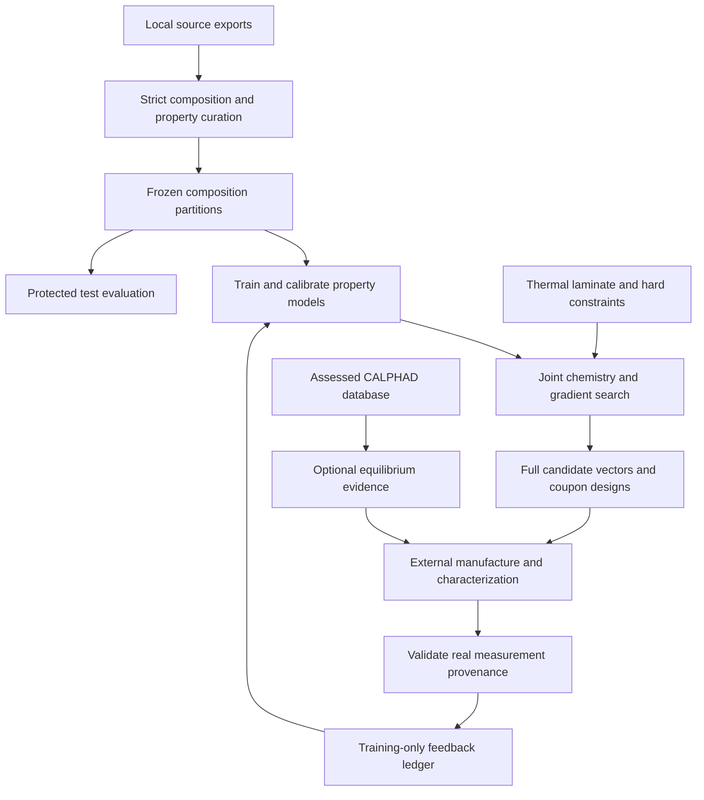

# Workflow, models and inverse design

## What HE-MCGA currently is

The project explores a refractory multicomponent alloy transitioning by volume fraction into a ceramic. The proposed value is a repeatable method to choose composition and gradient geometry for a thermal application, then reduce uncertainty using measured feedback. The current deliverable is computational screening of coupon hypotheses. It does not demonstrate that a manufacturable, oxidation-resistant or load-bearing graded component exists.

## Connected workflow

Manufacture and characterization are external activities. No physical cycle has yet traversed those nodes. CALPHAD is an optional, separate evidence step, not a fabricated default or an automatic pass gate.

## Stage contracts

| Stage | Actual implementation | Input | Output and limit |
|---|---|---|---|
| Composition | `he_mcga/composition.py` | Stoichiometric source formula or explicit atomic fractions | Complete normalized nine-element vector; unknown elements and incomplete fraction mappings rejected |
| Curation | `data.py` | MP local CSV and EXP-MPEA local CSV | Row-level accepted/rejected logs; no synthetic fallback or missing-temperature imputation |
| Property models | `models.py` | Curated composition descriptors; yield temperature and processing | ExtraTrees bulk GPa and compression YS MPa; separate reference calculation and experimental targets |
| Evaluation | `models.py` | Frozen SHA-256 composition partitions | Protected test and median baseline; training-only grouped CV; stronger publication/composition connected-block CV for yield |
| Thermophysical estimates | `composition.py` | Atomic fractions and declared elemental constants | Density, CTE, Young modulus and conductivity mixture estimates; not ML or alloy measurements |
| Thermal mechanics | `thermal.py` | Geometry, ceramic, explicit face K and mechanical constraint | Heat flux, curvature, in-plane stresses, force/moment residuals and layer fields |
| Inverse screen | `search.py` | Nine chemistry logits, exponent, thickness and fixed application config | All evaluations, postvalidated feasible candidates, Pareto flags, weighted-score shortlist and diverse measurement proposals |
| Evidence feedback | `feedback.py` | Real report-backed JSON | Atomic ledger update, retraining on eligible groups, new run hashes and outputs |
| Thermodynamics | `calphad.py` | User-supplied assessed TDB and composition | Equilibrium phase mole fractions with database fingerprint; no result when required evidence is absent |
| Application economics | `applications.py` | Declared tooling scenario | Break-even life ratio and simple cost arithmetic; no asserted customer savings |

## Composition and materials calculations

The search alphabet is Mo, Nb, Ta, W, Cr, V, Ti, Zr and Hf. Al was added after optimization in a historical recipe without model support. Phase 1 does **not** carry that unmodeled addition forward. Exploring Al requires expanding and validating the data/model alphabet, then rerunning every stage; it cannot be added to a finished recipe while retaining prior predictions.

Source formulas use stoichiometric coefficients, so `Nb2Mo2` normalizes to equal atomic fractions. Explicit fraction JSON must already sum to one within `1e-8`; a historical recipe summing to 0.992 is rejected rather than silently repaired. Canonical group identity uses the full element set and fractions rounded to eight decimal places solely for grouping; exported candidate vectors retain their full floating precision.

For atomic fractions x, molar masses M and elemental densities rho:

- Mean molar mass = sum(x_i M_i).
- Additive molar volume = sum(x_i M_i/rho_i).
- Density = mean molar mass / additive molar volume.
- Mass fraction w_i = x_i M_i / sum(x M).
- Volume fraction v_i = (x_i M_i/rho_i) / sum(x M/rho).

These are additive-volume estimates, not measured alloy densities. Alloy CTE is a volume-weighted estimate; conductivity and Young modulus use harmonic mixture estimates. Elemental constants are inherited reference assumptions. They are not validated temperature-dependent alloy properties. Young modulus is **not** obtained by multiplying a predicted bulk modulus by 1.2. Bulk modulus alone cannot determine Young modulus without additional elastic information.

Size mismatch, VEC and ideal configurational entropy are descriptors. The old ten-pair mixing-enthalpy table covers only the original five-element space. A missing pair now yields `unknown`, not zero interaction. Neither VEC nor a descriptor threshold establishes BCC single-phase stability, oxidation protection, ductility or ceramic compatibility.

## ML and uncertainty

Each model has 17 chemistry features: nine fractions and the mean/spread of radius, VEC, melting temperature and atomic mass. The compression-yield model adds test temperature in degrees C (converted from explicit K) and five fixed processing indicators, for 23 features. A fixed ExtraTrees regressor uses 96 trees, minimum leaf size 2 and the recorded seed. No hyperparameter search uses test labels.

Groups are assigned by `SHA256(seed:composition_id) mod 10`: 0–1 test, 2–3 calibration, 4–9 training. Equivalent formulas and all temperatures/processing states of one composition share a partition. The estimator used for candidate prediction is fitted only on training rows. Calibration and test rows are not silently refitted into a deployment model.

Calibration uses one maximum absolute residual per calibration composition. The nominal 90% split-conformal order statistic is `ceil((n_groups+1)*0.9)`. If that rank exceeds the available groups, the interval is unbounded and exported as null. Tree disagreement is a separate acquisition heuristic, not a posterior standard deviation. A composition L1 distance exceeding the training nearest-neighbor 95th percentile, an unseen element or processing condition, or out-of-range yield temperature flags extrapolation. Passing this distance check does not prove in-distribution behavior, especially across laboratories or processing details. Coverage assumes exchangeable groups, which is not established for prospective manufactured candidates.

The reference yield interval is so broad that the lower bound is zero for the top candidates. That is a negative result about current knowledge. The search is largely distinguishing thermal/density estimates and proximity, not proving superior high-temperature strength.

## Thermal mechanics

The cold alloy face is z=0 and the hot ceramic face z=L. Ceramic volume fraction follows `(z/L)^n`. Each layer uses its exact average of this function, conserving total ceramic volume `L/(n+1)` even with 11 manufacturing layers.

For layer thickness d and conductivity k, total thermal resistance per area is sum(d/k). Imposed face temperatures give heat-flux magnitude `q = (T_hot-T_cold)/sum(d/k)`. Temperature is linear within each constant-property layer and continuous across boundaries. Heat flows toward the cold face. These are **face temperatures**, not hot-gas temperatures; convection/radiation are not inferred.

The bonded laminate uses small-strain, equibiaxial plane stress with `Q = E/(1-nu)`. In-plane strain is `epsilon_0 + curvature*(z-L/2)`. Thermal eigenstrain is `alpha*(T-T_stress_free)`, and stress is Q times the difference between mechanical and thermal strain.

For the freely curving laminate, a 2x2 extensional/bending system solves epsilon_0 and curvature so integrated force and moment match the applied resultants. For the flat laminate, curvature is constrained to zero; force equilibrium is solved and the reaction moment is reported. Two-point Gaussian integration is exact for the layerwise property/linear-temperature approximation. There is no invented creep relaxation, edge multiplier, interfacial shear or ceramic fracture criterion.

This model checks mathematical consistency for an assumed elastic laminate. It does not include an actual substrate, bond-coat oxide, anisotropy, residual sintering stress, plasticity, creep, transient thermal cycles, cracks, oxidation growth, contact, gas loading or component geometry. Its peak in-plane stress is not a bond stress or an allowable. The isolated constant-area rotating-blade load utility is unit-tested but no component geometry/load has been assumed or qualified.

## Search and selection

The seeded DE search optimizes nine logits (softmax yields the complete atomic fractions), exponent n in [0.5,3] and thickness in [0.5,5] mm. Ceramic type is fixed by the application configuration, not optimized. All nine fractions are exported; none is discarded below 1 at%.

Hard screening constraints require at least five elements at >=5 at%, no element above 35 at%, configured Cr minimum, V maximum, additive-volume density limit and heat-flux ceiling. These design bounds are analyst choices; the Cr/V limits do not certify oxidation or phase stability. A candidate is rechecked before export. If none is feasible, the run fails instead of reusing a stale recipe.

The minimized score is:

`peak_stress_MPa/1000 + 0.2*density_g_cm3/10 - 0.2*max(0,YS_lower_MPa)/1000 + 0.25*nearest_composition_L1 + 0.5*(yield_domain_flag_count)`.

The score is an explicit heuristic, not a safety factor or economic benefit. A separate Pareto mask minimizes stress and density and maximizes the compression-yield lower bound. An equal-budget seeded uniform random search uses the same bounds and feasibility rules. Reference comparisons are single-seed diagnostics; they do not establish broad optimizer superiority. The proposed batch combines low-score and high-tree-disagreement points with composition diversity. It does not calculate Bayesian expected improvement or demonstrate information gain experimentally.

## Reproduction and result authority

The source CSV hashes, exact code hashes, dependency versions, configuration hash, seed, feedback hash, base commit and artifact hashes are recorded in each `manifest.json`. A dirty working-tree flag correctly identifies that reference results were generated from code changes before their final commit; code hashes identify what actually ran. Results are not silently substituted for historical runs. Reusing an output directory is prohibited. The 11-layer exported design has a separate `coupon_recipe_screening.json`; do not substitute the 80-layer screening stress for the discretized manufacturing proposal.
